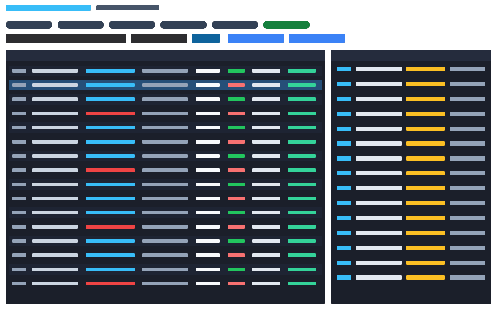

# FIX Protocol Viewer for VS Code

Open FIX trading message files in the editor. A `.fix` or `.fixlog` file packs tag=value pairs separated by SOH (`0x01`) or pipe (`|`) characters into one flat line per message, and raw text hides what each tag means. This extension decodes FIX 4.2, 4.4, 5.0 and FIXT.1.1 messages locally with plain JavaScript, without an external engine or cloud upload.

## What it opens

- `.fix` and `.fixlog` files using SOH (`\x01`), pipe (`|`), or caret (`^A`) delimiters, including timestamped log prefixes before `8=FIX`. Nothing to install, nothing uploaded.

## The free part

- Message table: sequence number (`34`), sending time (`52`), decoded message type (`35`), session (`49->56`), symbol (`55`), side (`54`), quantity (`38`), price (`44`), client order ID (`11`) and order status (`39`).
- Tag inspector: click any message to inspect every tag number, standard FIX tag name, raw value and decoded enum label in one table.
- Search and filter: filter messages by text, message type or session pair locally.
- Session and check summary: message counts per session, sequence gap indicators, BodyLength (`9`) checks and CheckSum (`10`) checks.

## The Pro tools, with 1 free try

Pro adds the audit and output steps: run a session sequence-gap and checksum audit report in Markdown, export decoded messages and tags to CSV and JSON (`messages.csv`, `tags.csv`, `messages.json`), or compare order lifecycles across two FIX files by `ClOrdID` and `OrderID`. Your first try of each Pro tool is free. Zovo Pro is USD 19 once, and the team licence is USD 59.

## Why not raw text

Incident review on FIX logs is a check job: did sequence 42 drop, did the venue reject `ClOrdID` `ORD-1002`, did the checksum match. Numeric tag strings answer none of it at a glance. A decoded table with session checks answers it on one screen, offline.

## More tools by Zovo

See full docs and install options at [vscode.zovo.one/extensions/zovo-fix-viewer/](https://vscode.zovo.one/extensions/zovo-fix-viewer/), browse all Zovo VS Code extensions at [vscode.zovo.one](https://vscode.zovo.one/), or explore [Zovo Pro](https://vscode.zovo.one/pro/).
